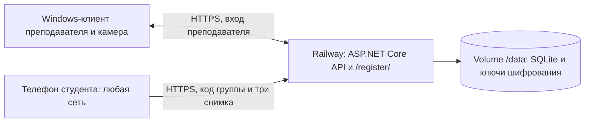

# Регистрация лица через интернет

## Что меняется

BiStudent — Windows-приложение для преподавателя: журнал, расписание, оценки, посещаемость по распознаванию лиц. Студент открывает сайт `/register/`, вводит код группы и отправляет три снимка. Регистрация вступает в силу после подтверждения преподавателя.

Проверки SSID или общего Wi-Fi в API нет. Ограничение возникает из-за адреса `http://192.168.…:5080`: он доступен только внутри сети колледжа. HTTPS-адрес публичного сервера позволяет открыть тот же сайт через домашний Wi-Fi или мобильный интернет. Одного изменения `Enrollment:PublicUrl` недостаточно: по этому адресу должен работать сам API с нужными группами и заявками.

Здесь используется существующий сервер. Новая база данных или отдельный сервис распознавания не нужны.



На Railway переносятся API, регистрация, проверка снимков и база. Интерфейс преподавателя и камера остаются в Windows. Это один контейнер с OpenCV, а не сверхлёгкий сервер-посредник. Распознавание во время занятия тоже выполняется на удалённом API; кадры идут через интернет. При недоступности сервера клиент в этом режиме не работает офлайн. Автоматического переключения между двумя базами нет.

## 1. Подготовить исходники

Репозиторий этой версии: [madinaniyazova2023/BiStudent](https://github.com/madinaniyazova2023/BiStudent). Подключайте его ветку `main` к Railway. Предварительно устанавливать SDK на Railway не нужно — сборку выполняет Dockerfile. Для локальной разработки нужны Windows x64, .NET 10 SDK, Node.js 24 и Git. Расширения редактора для сборки и тестов не обязательны.

В корне репозитория:

```powershell
dotnet restore BiStudent.slnx
dotnet build BiStudent.slnx -c Release --no-restore -warnaserror
dotnet test --solution BiStudent.slnx -c Release --no-build
node --test tests/site/register.test.cjs
```

NuGet устанавливает OpenCvSharp, EF Core/SQLite, ClosedXML, xUnit и другие зависимости из файлов проектов. Модель SFace скачивается при первой сборке и проверяется по SHA-256. На Railway .NET SDK и системные библиотеки OpenCV устанавливает Dockerfile.

## 2. Создать сервис Railway

1. В Railway нажмите **New Project → Deploy from GitHub repo** и выберите **madinaniyazova2023/BiStudent**, ветку **main**. Если репозиторий не виден, откройте настройку доступа приложения Railway в GitHub и разрешите ему этот репозиторий.
2. Корневая папка сервиса — корень репозитория, не `BiStudent.Server`: сборке нужен соседний `BiStudent.Core`.
3. Файл `railway.json` выбирает `BiStudent.Server/Dockerfile`, проверку `/health` и одну реплику. Если автоматическая сборка стартовала до настройки переменных и тома, настройте их и выполните повторное развёртывание.
4. Создайте постоянный **Volume** и подключите к сервису по пути **`/data`**. SQLite, образцы лиц, ключи и автоматические копии лежат здесь. Без тома повторное развёртывание может потерять данные и ключи.
5. В Settings → Networking → Public Networking нажмите **Generate Domain**, целевой порт **8080**. Сохраните HTTPS-адрес.

Railway выпускает сертификат HTTPS для публичного домена: [Public Networking](https://docs.railway.com/networking/public-networking). Путь Dockerfile задаётся конфигурацией: [Dockerfiles](https://docs.railway.com/builds/dockerfiles), [Config as Code](https://docs.railway.com/config-as-code/reference).

## 3. Задать Variables

Откройте `deploy/railway.env.example` и перенесите значения в Variables сервиса. Замените `YOUR-SERVICE` на выданный домен, а значение `Setup__AdminPassword` — на случайный пароль не короче 12 символов. Образец пароля из файла использовать нельзя.

Основные значения:

| Переменная | Значение / назначение |
|---|---|
| `PORT` | `8080` |
| `ASPNETCORE_URLS` | `http://+:8080` — внутренний HTTP; внешний HTTPS даёт Railway |
| `ASPNETCORE_ENVIRONMENT` | `Production` |
| `ConnectionStrings__Default` | `Data Source=/data/bistudent.db` |
| `Hosting__Public` | `true` — проверяет HTTPS-адрес, запрещает демо и слабый стартовый пароль |
| `Hosting__RailwayProxy` | `true` — получает адрес клиента из `X-Real-IP` для ограничения запросов |
| `Enrollment__PublicUrl` | `https://YOUR-SERVICE.up.railway.app` — без `/register/` |
| `Setup__AdminLogin` | `admin` |
| `Setup__AdminPassword` | Ваш случайный пароль длиной от 12 символов |
| `Demo__Enabled` | `false` |
| `Firebase__ApiKey` | Пустое значение для отдельной установки |
| `Firebase__ProjectId` | Пустое значение для отдельной установки |
| `RAILWAY_RUN_UID` | `0` — доступ к подключённому тому |
| `TZ` | `Asia/Qyzylorda` — расписание использует местное время |
| `OMP_NUM_THREADS`, `OPENBLAS_NUM_THREADS` | `1` — ограничение потоков нативных библиотек |

В этой версии оба значения Firebase уже пустые в `BiStudent.Server/appsettings.json`. Переменные `Firebase__ApiKey` и `Firebase__ProjectId` можно не добавлять, если Railway не сохраняет пустые значения. Не заполняйте их, пока не создадите собственный проект Firebase. Для регистрации лиц и входа преподавателя на Railway Firebase не требуется.

Railway монтирует том от root; текущий Dockerfile по умолчанию использует пользователя app, поэтому документация Railway указывает `RAILWAY_RUN_UID=0`: [права Volume](https://docs.railway.com/volumes#permissions).

`Hosting__RailwayProxy=true` применяйте только за HTTP edge Railway. Не открывайте этот же порт через TCP proxy: доверие к заголовкам рассчитано на платформенный HTTP-прокси. При таком режиме адрес клиента берётся из добавленного Railway `X-Real-IP`, чтобы один студент не исчерпывал лимит всех посетителей. См. [заголовки Railway](https://docs.railway.com/networking/public-networking/specs-and-limits). Ограничения по IP остаются общими для телефонов за одним NAT.

Запустите Deploy. Откройте `https://ВАШ-ДОМЕН/health`: ожидается `Healthy`. Затем откройте `https://ВАШ-ДОМЕН/register/`.

## 4. Подключить Windows-клиент

Соберите клиент из изменённых исходников; старый опубликованный релиз не содержит изменения выбора сервера:

```powershell
dotnet publish BiStudent/BiStudent.csproj -c Release -r win-x64 --self-contained true -o out/CloudClient
```

Запустите `out/CloudClient/BiStudent.exe`. В поле **«Адрес сервера»** введите `https://ВАШ-ДОМЕН`, без `/register/`. Войдите как `admin` с паролем из Variables, после чего смените пароль. Адрес сохранится для следующих запусков. Сохранённый токен от другого сервера к этому адресу не применяется.

Папка `Server` рядом с клиентом больше не заставляет работать локально. Встроенный сервер запускается только для выбранного адреса `http://localhost:5080` или другого loopback-адреса на порту 5080. Для локального режима можно вернуть этот адрес; это будет другая база, если вы не перенесли данные.

При новой установке создайте группы и студентов или импортируйте списки. Создайте преподавателей. Все преподаватели, которым нужны общие заявки и образцы лиц, должны подключаться к одному серверу.

## 5. Если уже есть локальные данные

Не импортируйте рабочие данные до проверки новой установки на тестовой группе.

1. На старом сервере войдите администратором, смените пароль `admin`, если он ещё используется, и скачайте штатную резервную копию в «Администрирование». Копия включает SQLite и ключи расшифровки лиц.
2. На новом сервере войдите администратором и восстановите эту копию через «Администрирование». Это **заменит данные нового сервера**, не объединит их; перед восстановлением скачайте его копию, если там уже есть нужные данные.
3. После восстановления войдите заново учётной записью из старой базы. `Setup__AdminPassword` действует только при создании пустой базы, а не как сброс старого пароля.
4. Сравните количество групп, студентов и образцов; проверьте просмотр заявок и распознавание на тестовых данных. После переноса выдайте новый код регистрации с облачной ссылкой.
5. Скачайте контрольную резервную копию с нового сервера. На время перехода не редактируйте один журнал одновременно в двух независимых установках.

Не переносите один `bistudent.db` без `keys`: сохранённые образцы окажутся нечитаемыми. Для независимого сервера Railway шаблон отключает Firebase; синхронизации с локальными копиями при этом нет. Подключение к прежнему Firebase — отдельный вариант, требующий доступа и проверки конфликтов данных. В существующей реализации синхронизация отправляет образцы лиц в Firestore, поэтому это не только синхронизация журнала.

## 6. Проверить регистрацию без общего Wi-Fi

1. В клиенте, подключённом к Railway, откройте «Группы» → «Код регистрации».
2. Проверьте, что ссылка и QR содержат облачный HTTPS-домен, а не `192.168.…`, `localhost` или внутренний адрес контейнера.
3. На телефоне выключите Wi-Fi, оставив мобильный интернет, и откройте ссылку.
4. Введите код, выберите тестового студента, дайте согласие и разрешите браузеру камеру. Сделайте три разных снимка.
5. Отправьте заявку. Она должна появиться в «Заявках на регистрацию» того же сервера; подтвердите её и проверьте статус студента.
6. Перезапустите сервис Railway и убедитесь, что данные и снимки читаются. Это проверит подключение Volume и сохранность ключей.

Сценарий API «отдельный анонимный клиент отправляет снимки → преподаватель подтверждает» покрыт `BiStudent.Tests/PublicHostingTests.cs`. Автотест не заменяет проверку камеры на реальном телефоне и реального Railway-развёртывания.

## Бесплатность и небольшой сервер

Условия проверены 04.11.2026. Railway даёт пробные $5 на 30 дней, затем Free предоставляет $1 кредита в месяц; лимит памяти Free — 0,5 ГБ. Это ограниченный бесплатный объём, а не гарантия круглосуточной работы без оплаты. См. [Free Trial](https://docs.railway.com/pricing/free-trial) и [Plans](https://docs.railway.com/pricing/plans).

Этот сервер загружает модели OpenCV и обрабатывает фотографии. Фактическую пиковую память и стоимость нужно измерять на Railway во время отправки снимков и распознавания группы. Локальный Windows-тест не доказывает, что сервер уложится в 0,5 ГБ. Включите контроль расходов в аккаунте; для SQLite оставьте одну реплику. Постоянный том нужен даже при использовании режима сна; пробуждение может задержать первый запрос.

Если нужен именно маленький публичный посредник, можно следующим этапом вынести только сайт и зашифрованную очередь заявок: локальный сервер сам забирает их исходящими HTTPS-запросами, проверяет лица и подтверждает получение. Потребуются отдельные учётные данные устройств, защита от повторов, срок хранения, удаление снимков и надёжная привязка студентов. Это отдельная разработка; в текущие изменения такой посредник не входит. Статический сайт на хостинге сам по себе не сможет обращаться к `localhost` преподавателя.

## Диагностика

| Симптом | Что проверить |
|---|---|
| Ошибка `Enrollment:PublicUrl` в логах | Полный HTTPS-адрес корня, без `/register/`, пробелов внутри, query-параметров |
| Ошибка `Setup:AdminPassword` | На пустой базе пароль должен содержать минимум 12 символов |
| Ошибка доступа к `/data` | Volume подключён к этому сервису, путь `/data`, переменная `RAILWAY_RUN_UID=0` |
| 502 / Application failed to respond | `PORT=8080`, `ASPNETCORE_URLS=http://+:8080`, target port домена 8080; проверьте логи запуска |
| Пустые группы | Клиент подключён к новой базе; выполните импорт или восстановление |
| Код не найден | Код выдан другим сервером, отозван или истёк; выдайте код на Railway |
| Нет доступа к камере | Страница открыта по HTTPS, камере разрешён доступ в браузере; при запрете можно загрузить файлы |
| 429 | Сработал лимит запросов; подождите. В Railway проверьте `Hosting__RailwayProxy=true` |
| Данные исчезают после Deploy | Отсутствует постоянный Volume или база записывается вне `/data` |
| Контейнер завершается при фото | Посмотрите память/OOM в Metrics; нужен больший лимит или отдельный посредник |

Образцы лиц и подтверждение преподавателем остаются частью регистрации. Код группы разрешает подать заявку за выбранного студента и не доказывает его личность. Проверки живого человека в проекте нет.
